# 🚀 Rapport TP 2 : CI/CD avec GitHub Actions

---

## ✍️ Exercice 1 : Workflow Backend

### 1. Fichier `.github/workflows/backend.yml`

```yaml
name: Backend Tests

on:
  push:
    branches: [main]
  pull_request:
    branches: [main]

jobs:
  backend:
    runs-on: ubuntu-latest

    steps:
      - name: Checkout code
        uses: actions/checkout@v7

      - name: Setup Python
        uses: actions/setup-python@v7
        with:
          python-version: '3.11'
          cache: 'pip'

      - name: Install UV
        run: pip install uv

      - name: Install dependencies
        run: |
          cd backend
          uv sync

      - name: Run tests
        run: |
          cd backend
          uv run pytest -v --cov
```

### 2. Vérification des tests en local (Terminal)

On observe les résultats attendus dans le terminal (18 tests réussis en raison des exos bonus réalisés au TP1) :

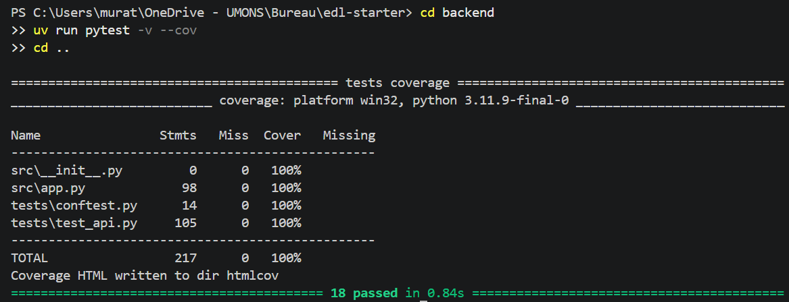

### 3. Exécution du workflow sur GitHub Actions

On observe les résultats attendus dans l'onglet 'Actions': 

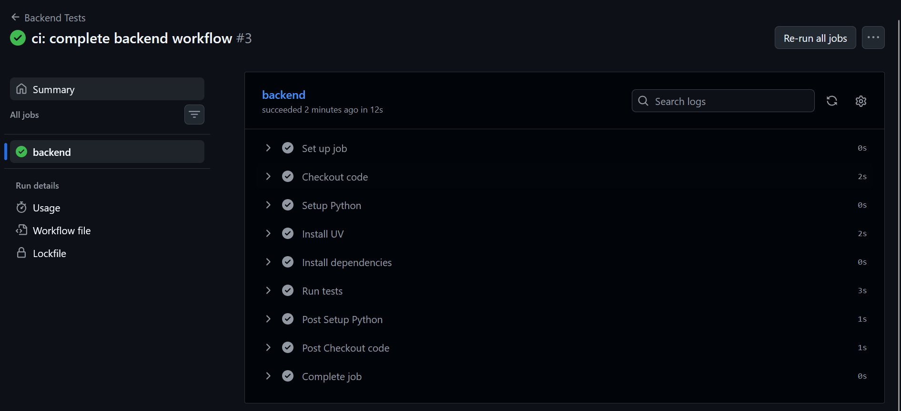

---

## ✍️ Exercice 2 : Workflow Frontend

### 1. Fichier `.github/workflows/frontend.yml`

```yaml
name: Frontend Tests

on:
  push:
    branches: [main]
  pull_request:
    branches: [main]

jobs:
  frontend:
    runs-on: ubuntu-latest

    steps:
      - name: Checkout code
        uses: actions/checkout@v7

      - name: Setup Node.js
        uses: actions/setup-node@v7
        with:
          node-version: '24'
          cache: 'npm'
          cache-dependency-path: frontend/package-lock.json

      - name: Install dependencies
        run: |
          cd frontend
          npm ci

      - name: Run tests
        run: |
          cd frontend
          npm test -- --run

      - name: Build
        run: |
          cd frontend
          npm run build
```

### 2. Vérification des tests et du build en local (Terminal)

On observe que les tests sont validés comme attendu:

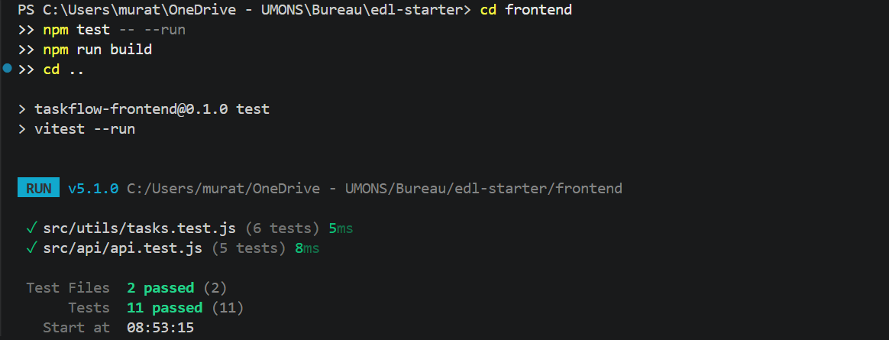

### 3. Exécution des deux workflows en parallèle sur GitHub Actions

On observe les résultats attendus dans l'onglet 'Actions': 


On peut voir clairement les deux workflows qui travaillent en parallèle: 


---

## ✍️ Exercice 3 : Déboguer un Échec

### 1. Introduction volontaire d'un bug dans `backend/tests/test_api.py`

On observe que sur GitHub, le workflow Backend échoue tandis que Frontend passe au vert.


### 2. Observation de l'échec et analyse des logs sur GitHub Actions

En ouvrant les logs, on découvre la cause du problème :


Le test `test_health_check` échoue avec une `AssertionError`, car l'API renvoie `"healthy"` au lieu de `"BROKEN"`.

### 3. Reproduction de l'erreur en local

On exécute le test en local afin de reproduire la même erreur sans devoir attendre un nouveau cycle complet sur GitHub Actions (le temps d'exécution est de 0.49s)


### 4. Correction du bug et validation

On rétablit l'assertion (`"healthy"`), on vérifie que le test repasse au vert en local, puis on pousse le correctif sur `main` : 

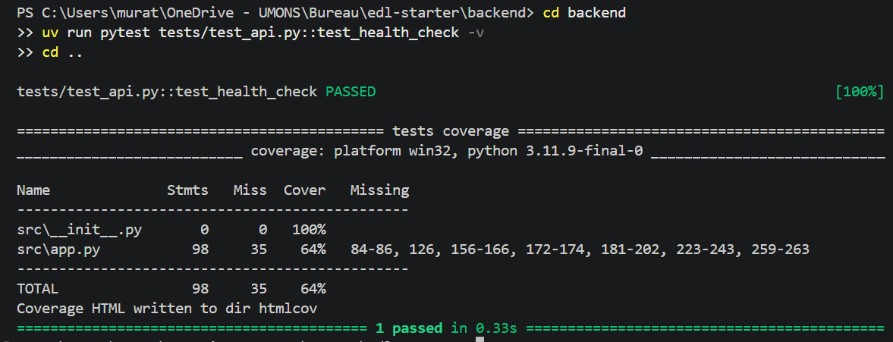

Le workflow **Backend Tests** redevient vert sur GitHub: 

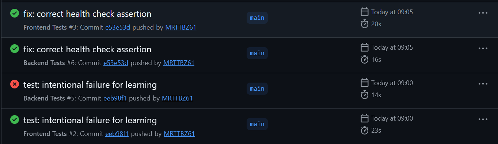
---

## ✍️ Exercice 4 : Protection de Branches

### Partie 1 : Activer la Protection de Branche (`main`)

Dans les paramètres du dépôt, on crée une règle de protection sur la branche `main`. On active l'option **Require status checks to pass before merging** en exigeant la réussite des jobs `backend` et `frontend` avant tout merge.

### Partie 2 : Tester avec une Branche Qui Casse les Tests (PR bloquée)

On crée une branche `feature/test-branch-protection`, on introduit volontairement un bug dans `backend/tests/test_api.py`, puis on ouvre une Pull Request vers `main`. 
GitHub lance automatiquement les workflows : le check `backend` échoue et le bouton **Merge pull request** est bloqué, empêchant le bug d'atteindre `main`.

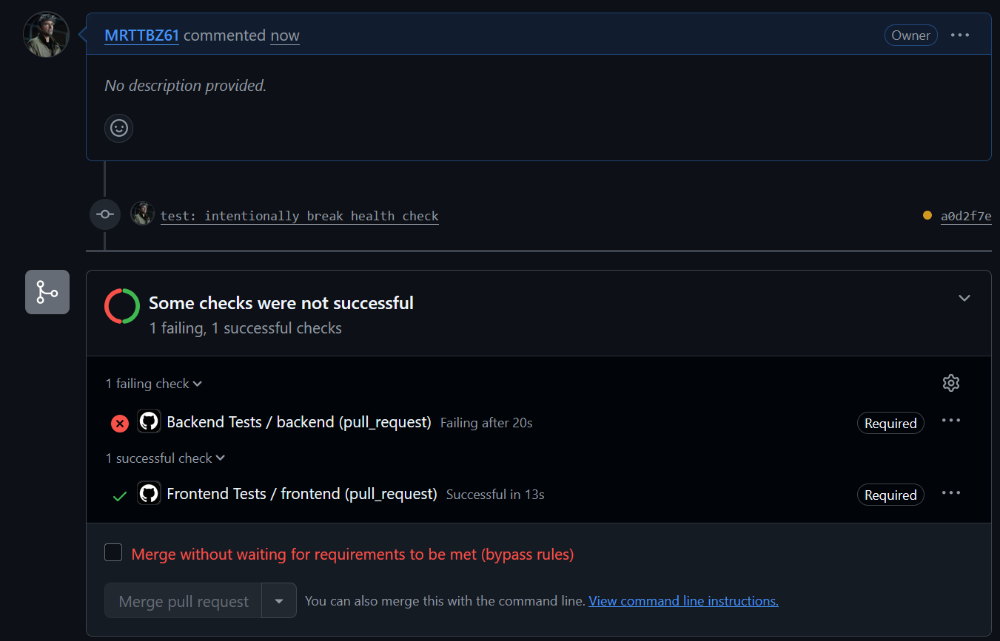

### Partie 3 : Corriger et Merger (PR débloquée)

On corrige l'assertion sur la même branche (`"healthy"`) et on pousse le correctif. Les workflows se relancent automatiquement : une fois les checks `backend` et `frontend` passés au vert, le bouton de merge se débloque. On valide le merge de la PR, puis on met à jour `main` en local et on supprime la branche temporaire.


---

## ✍️ Exercice 5 : Workflows Réutilisables

### 1. Passage de `backend.yml` et `frontend.yml` en `workflow_call`

Dans `backend.yml` et `frontend.yml`, on remplace `push` et `pull_request` par `workflow_call`. Ces deux fichiers ne se lancent plus tout seuls, mais uniquement lorsqu'ils sont appelés par le pipeline principal.

### 2. Création du pipeline global `.github/workflows/ci-pipeline.yml`

On crée `ci-pipeline.yml` qui exécute les deux workflows en parallèle (`backend` et `frontend`), à chaque `push` ou `pull_request` sur `main`, suivi d'un job final `summary` (`All Tests Passed`).


### 3. Mise à jour de la protection de branche (`All Tests Passed`) et résultat

On remplace les anciens checks (`backend` et `frontend`) par le check **`All Tests Passed`**, ce qui simplifie la maintenance si de nouveaux workflows sont ajoutés plus tard. Sur GitHub Actions, un seul workflow **CI Pipeline** apparaît désormais par push, regroupant les 3 jobs au vert.


---

## ✍️ Exercice 6 : Séparer Tests Unitaires et E2E

### Partie 1 : Marquer les tests E2E et tester en local

Le filtrage fonctionne bien en local :

- **Tests unitaires uniquement** (`-m "not e2e"`) : 18 passés, 1 désélectionné.
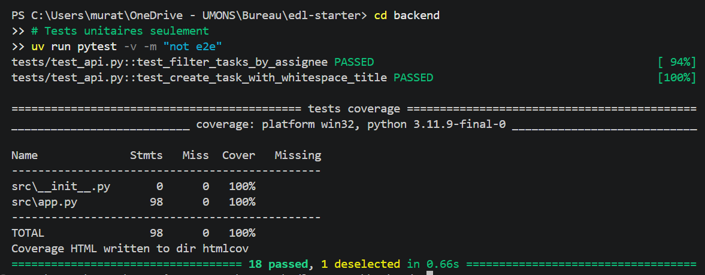

- **Tests E2E uniquement** (`-m "e2e"`) : 1 passé, 18 désélectionnés.


- **Tous les tests** (`pytest -v`) : les 19 tests passent.


### Partie 2 : Séparer les jobs dans `.github/workflows/backend.yml`

Le workflow backend est découpé en deux jobs (`unit-tests` et `e2e-tests`), avec exécution des tests E2E restreinte à `main` et conditionnée à la réussite des tests unitaires.

### Partie 3 : Vérification du comportement (`main` vs Pull Request)

Sur `main`, les deux jobs s'exécutent et passent au vert :

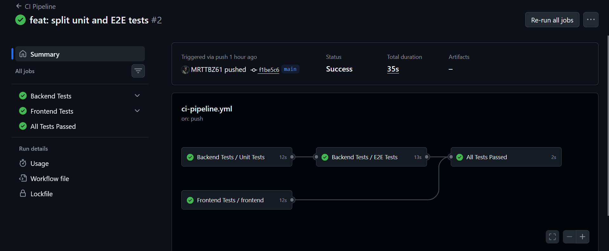

Sur la Pull Request, `E2E Tests` est bien ignoré (*skipped*) tandis que `Unit Tests` et `All Tests Passed` restent verts : 

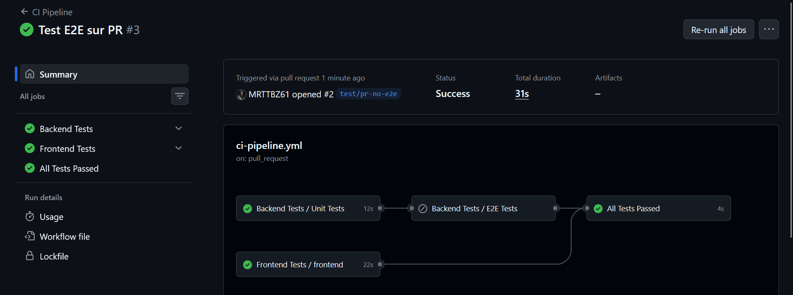

---

## ✍️ Exercice 7 : Badges de Status

### 1. Modification de `README.md`

On ajoute en haut du fichier `README.md` le badge Markdown pointant vers `action/workflows/ci-pipeline.yml/badge.svg` sur notre dépôt GitHub.

### 2. Résultat du badge sur GitHub

Une fois poussé sur `main`, le badge s'affiche en vert (`passing`) directement sur la page d'accueil du dépôt GitHub, indiquant en temps réel l'état du dernier pipeline CI.

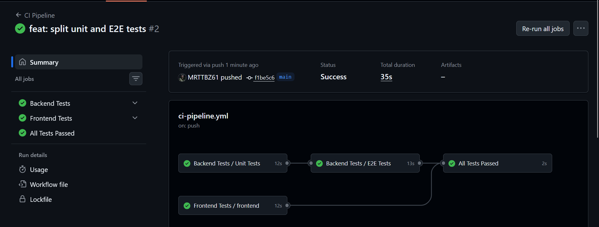

---

## 🎁 BONUS : Workflow Java (Optionnel)

Le workflow `java.yml` a été déclenché manuellement depuis GitHub (`Actions → Run workflow`) grâce à `workflow_dispatch` : les tests des exercices `calculs-geo` et `money` passent au vert.

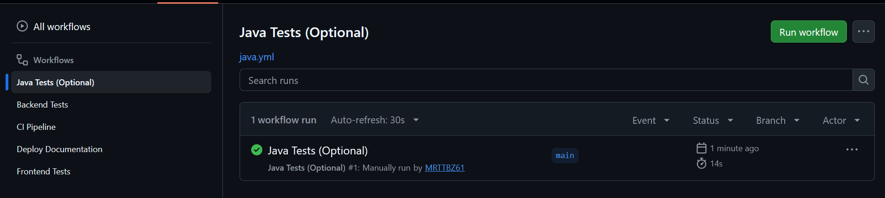
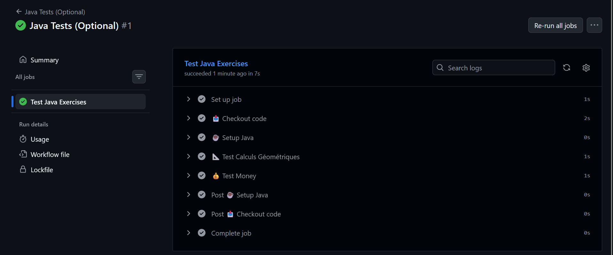
---

