INCLURE BACKEND.YML (CODE)

ICI JE MONTRE TERMINAL
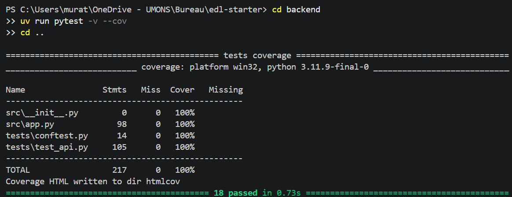

ICI JE MONTRE SUR GITHUB

INCLURE FRONTEND.YML (CODE)

ICI JE MONTRE TERMINAL

ICI JE MONTRE SUR GITHUB
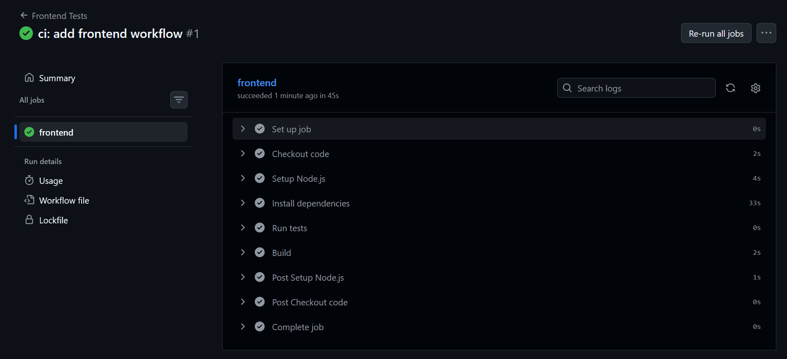

ICI JE MONTRE QU'ON VOIT LES DEUX WORKFLOW
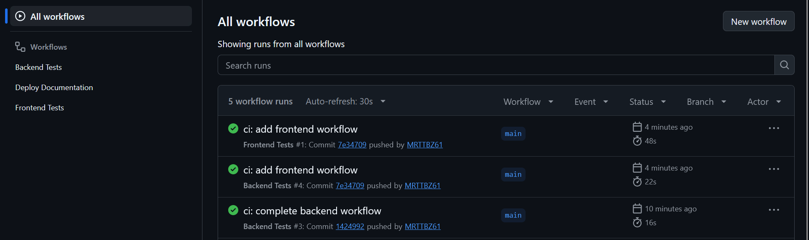

JE VOIS SUR GITHUB L'ERREUR ONLY BACKEND
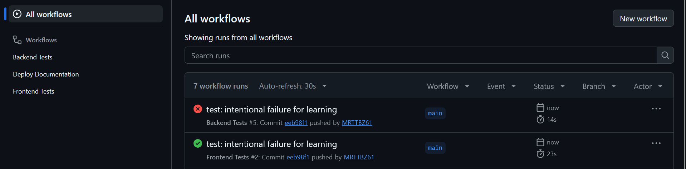

ICI ON VOIT LA LIGNE QUI CAUSE PROBLEME
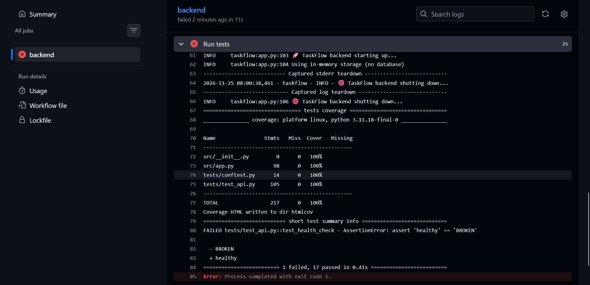

ON TEST L'ERREUR LOCALEMENT
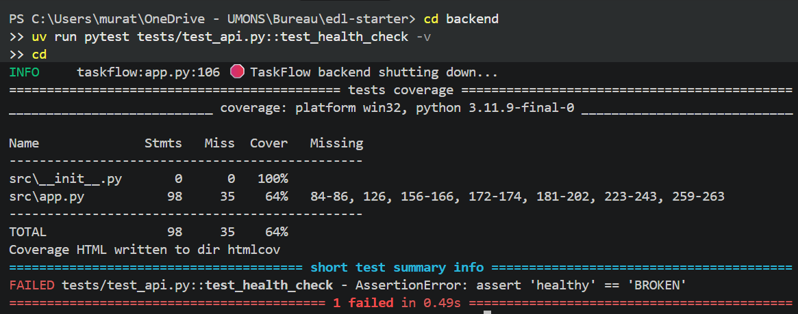

ON CORRIGE l'ERREUR ET ON REEXECUTE

ON OBSERVE QU'ON NE PEUT PAS MERGE SI LES TESTS SONT PAS BONS

APRES LE CHANGEMENT ON PEUT CLIQUER
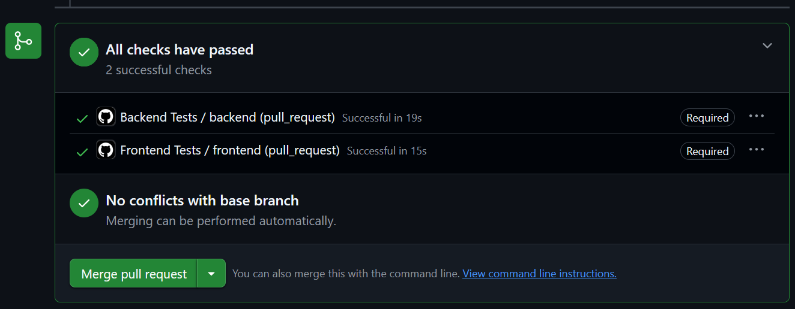

ON REMARQUE QU'IL N'Y A QU'UN SEUL WORKFLOW PAR PUSH
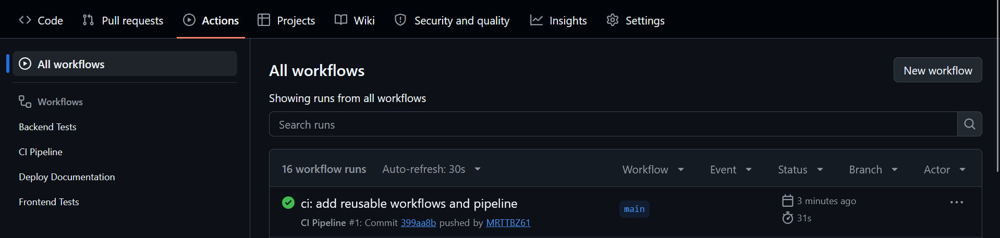
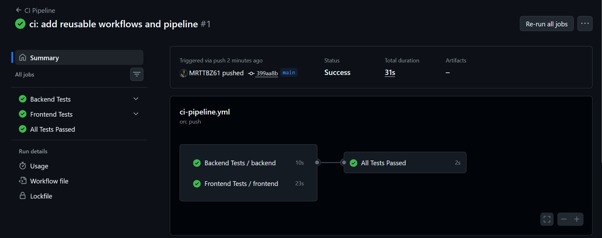

ON TESTE TOUT LES TEST SAUF CELUI QUI A LE MARQUEUR E2E

ON TEST UNIQUEMENT E2E
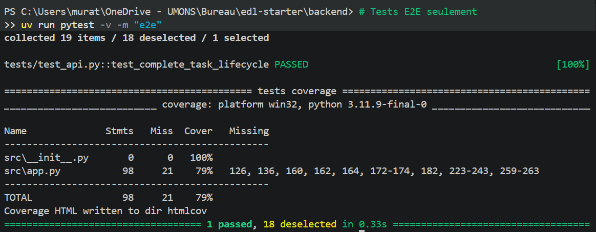

ON TESTE TOUT
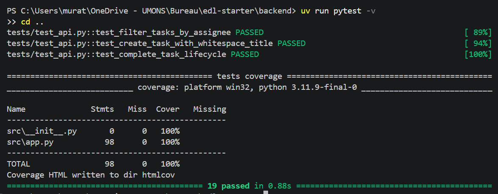

