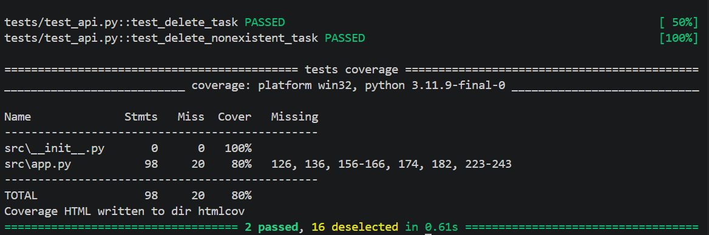
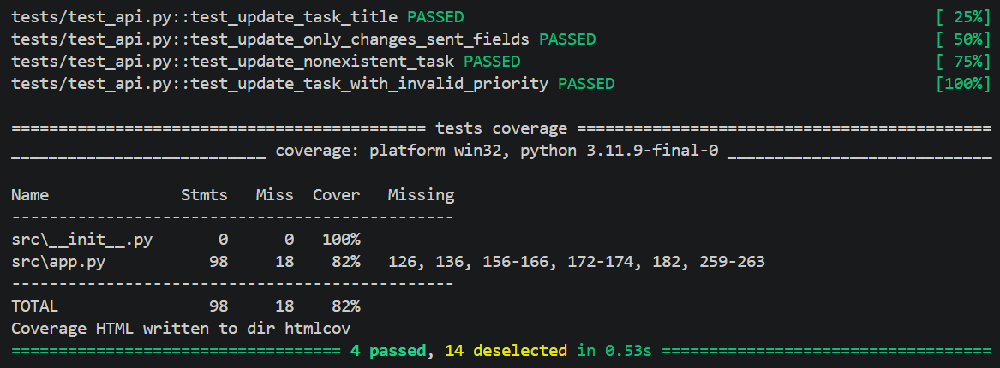
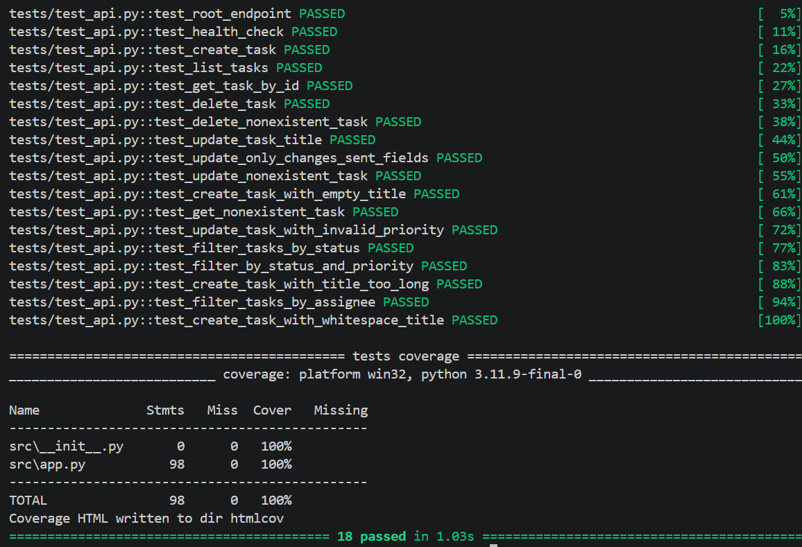
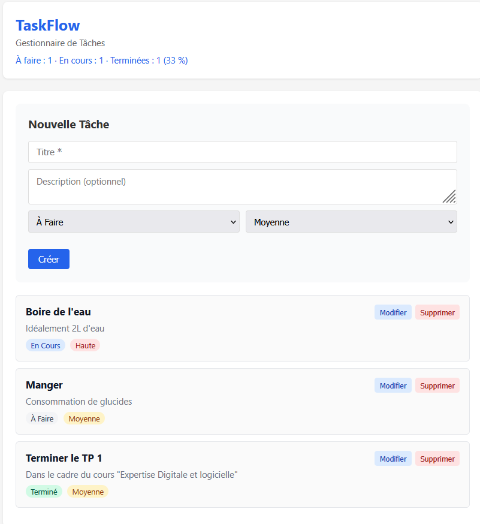
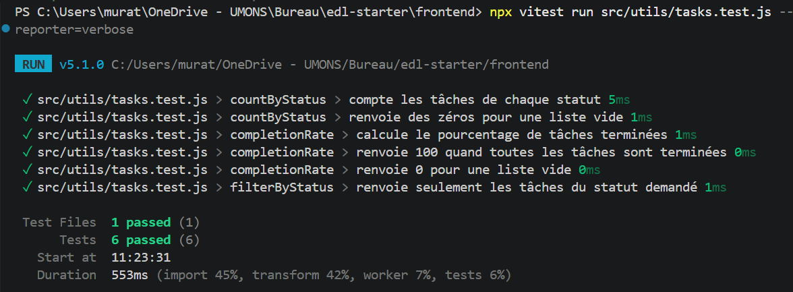
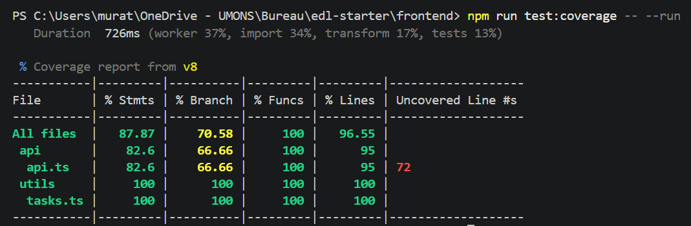
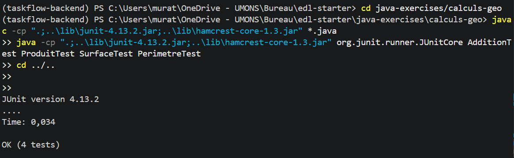
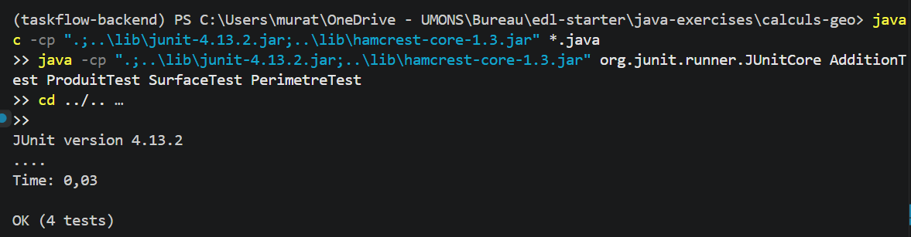

# 🎓 Rapport TP 1 : Tests Unitaires Backend & Frontend

**Introduction :**
Ce TP porte sur le **TDD** (*Test-Driven Development*) côté backend (Python avec **pytest**) et côté frontend (TypeScript avec **Vitest**).

Le fork est accessible depuis le lien https://github.com/MRTTBZ61/edl-starter.

---

## Phase 4 : Écrire les Tests, puis le Code (Backend Python / pytest)

### Exercice 1 : Supprimer une Tâche

On écrit les deux tests unitaires selon le pattern **Arrange / Act / Assert**, puis on implémente `delete_task()` dans `app.py` pour les faire passer au vert.

#### Étape 1 : Tests dans `backend/tests/test_api.py`

```python
def test_delete_task(client):
    """Supprimer une tâche existante renvoie 204, puis la tâche n'existe plus (GET → 404)."""
    # ARRANGE
    create_response = client.post("/tasks", json={"title": "ID de la tâche à supprimer : "})
    task_id = create_response.json()["id"]
    
    # ACT
    response = client.delete(f"/tasks/{task_id}")

    # ASSERT
    assert response.status_code == 204
    check_response = client.get(f"/tasks/{task_id}")
    assert check_response.status_code == 404


def test_delete_nonexistent_task(client):
    """Supprimer une tâche qui n'existe pas renvoie 404."""    
    # ACT
    response = client.delete("/tasks/9999")

    # ASSERT
    assert response.status_code == 404
```

#### Étape 2 : Implémentation de `delete_task()` dans `backend/src/app.py`

La fonction vérifie d'abord la présence de `task_id` dans `tasks_db` (404 si absent), puis supprime l'entrée avec `del tasks_db[task_id]`.

```python
@app.delete("/tasks/{task_id}", status_code=204)
async def delete_task(task_id: int):
    """Delete a task by ID."""
    if task_id not in tasks_db:
        raise HTTPException(status_code=404, detail=f"Task {task_id} not found")

    del tasks_db[task_id]
    logger.info(f"Task deleted successfully: {task_id}")
```
On observe que tout est passé au vert : 



---

### Exercice 2 : Modifier une Tâche

#### Étape 1 : Tests dans `backend/tests/test_api.py`

```python
def test_update_task_title(client):
    """Modifier le titre d'une tâche renvoie 200 et la tâche avec le nouveau titre."""
    # ARRANGE
    create_response = client.post("/tasks", json={"title": "ancien titre"})
    task_id = create_response.json()["id"]
    
    # ACT
    response = client.put(f"/tasks/{task_id}", json={"title": "nouveau titre"})
    
    # ASSERT
    assert response.status_code == 200
    assert response.json()["title"] == "nouveau titre"


def test_update_only_changes_sent_fields(client):
    """Créez une tâche avec un titre, une description et une priorité,
    puis envoyez seulement {"status": "done"} : le statut change,
    mais le titre, la description et la priorité restent identiques."""
    # ARRANGE
    create_response = client.post("/tasks", json={
        "title": "S'exercer sur du code",
        "description": "Exercice 2",
        "priority": "high"
    })
    task_id = create_response.json()["id"]
    
    # ACT
    response = client.put(f"/tasks/{task_id}", json={"status": "done"})
    
    # ASSERT
    assert response.status_code == 200
    updated_task = response.json()
    assert updated_task["status"] == "done"
    assert updated_task["title"] == "S'exercer sur du code"
    assert updated_task["description"] == "Exercice 2"
    assert updated_task["priority"] == "high"


def test_update_nonexistent_task(client):
    """Modifier une tâche qui n'existe pas renvoie 404."""
    # ACT
    response = client.put("/tasks/999", json={"title": "Nouveau titre"})
    
    # ASSERT
    assert response.status_code == 404
```

#### Étape 2 : Implémentation de `update_task()` dans `backend/src/app.py`

On utilise `updates.model_dump(exclude_unset=True)` afin de n'extraire que les champs envoyés par le client. Ensuite, on utilise `update_data.get("champ", existing_task.champ)` pour conserver les valeurs existantes des champs non modifiés.

```python
@app.put("/tasks/{task_id}", response_model=Task)
async def update_task(task_id: int, updates: TaskUpdate) -> Task:
    """Update an existing task (partial update supported)."""
    if task_id not in tasks_db:
        raise HTTPException(status_code=404, detail=f"Task {task_id} not found")

    existing_task = tasks_db[task_id]
    update_data = updates.model_dump(exclude_unset=True)

    updated_task = Task(
        id=task_id,
        title=update_data.get("title", existing_task.title),
        description=update_data.get("description", existing_task.description),
        status=update_data.get("status", existing_task.status),
        priority=update_data.get("priority", existing_task.priority),
        assignee=update_data.get("assignee", existing_task.assignee),
        due_date=update_data.get("due_date", existing_task.due_date),
        created_at=existing_task.created_at,
        updated_at=datetime.now(timezone.utc)
    )

    tasks_db[task_id] = updated_task
    logger.info(f"Task updated successfully: {task_id}")
    return updated_task
```


---

### Exercice 3 : Tester le Code Existant

#### Tests dans `backend/tests/test_api.py`

```python
def test_create_task_with_empty_title(client):
    """Créer une tâche avec un titre vide ("") est refusé : 422."""
    # ACT 
    response = client.post("/tasks", json={"title": ""})
    
    # ASSERT
    assert response.status_code == 422


def test_get_nonexistent_task(client):
    """Demander une tâche qui n'existe pas renvoie 404."""
    # ACT
    response = client.get("/tasks/9999")
    
    # ASSERT
    assert response.status_code == 404


def test_update_task_with_invalid_priority(client):
    """Mettre à jour une tâche avec priority="urgent" est refusé : 422.
    (Les priorités valides sont "low", "medium" et "high".)"""
    # ARRANGE
    create_response = client.post("/tasks", json={"title": "Ma tâche"})
    task_id = create_response.json()["id"]
    
    # ACT
    response = client.put(f"/tasks/{task_id}", json={"priority": "urgent"})
    
    # ASSERT
    assert response.status_code == 422


def test_filter_tasks_by_status(client):
    """Créez une tâche "todo" et une tâche "done" : GET /tasks?status=done
    ne renvoie qu'une seule tâche, celle qui est terminée."""
    # ARRANGE
    client.post("/tasks", json={"title": "Tâche à faire", "status": "todo"})
    client.post("/tasks", json={"title": "Tâche terminée", "status": "done"})
    
    # ACT
    response = client.get("/tasks?status=done")
    
    # ASSERT
    assert response.status_code == 200
    tasks = response.json()
    assert len(tasks) == 1
    assert tasks[0]["status"] == "done"
```

---

### Bonus Python & Phase 5 (Couverture de Code à 100 %)

On réactive les deux tests bonus du fichier `test_api.py` (combinaison de filtres et test aux limites sur la longueur du titre à 200/201 caractères). Après on analyse le rapport de couverture pour découvrir les lignes manquantes de `app.py` (lignes 164 et 182) afin de faire deux nouvelles fonctions `test_filter_tasks_by_assignee` et `test_create_task_with_whitespace_title` d'atteindre 100 % de couverture.

#### 1. Tests désactivés réactivés (`backend/tests/test_api.py`)

```python
def test_filter_by_status_and_priority(client):
    """GET /tasks?status=todo&priority=high combine les deux filtres."""
    # ARRANGE
    client.post("/tasks", json={"title": "Bonne tâche", "status": "todo", "priority": "high"})
    client.post("/tasks", json={"title": "Mauvaise priorité", "status": "todo", "priority": "low"})
    client.post("/tasks", json={"title": "Mauvais statut", "status": "done", "priority": "high"})
    
    # ACT
    response = client.get("/tasks?status=todo&priority=high")
    
    # ASSERT
    assert response.status_code == 200
    tasks = response.json()
    assert len(tasks) == 1
    assert tasks[0]["status"] == "todo"
    assert tasks[0]["priority"] == "high"


def test_create_task_with_title_too_long(client):
    """Le titre est limité à 200 caractères : 200 est accepté (201), 201 est refusé (422).
    Astuce : "a" * 200 crée un texte de 200 caractères."""
    # ACT
    valid_response = client.post("/tasks", json={"title": "a" * 200})
    
    # ASSERT
    assert valid_response.status_code == 201
    
    # ACT
    invalid_response = client.post("/tasks", json={"title": "a" * 201})
    
    # ASSERT
    assert invalid_response.status_code == 422
```

#### 2. Couverture à 100 % — Lignes 164 et 182 de `app.py` (`backend/tests/test_api.py`)


```python
def test_filter_tasks_by_assignee(client):
    """Couvre la ligne 164 de app.py."""
    # ARRANGE
    client.post("/tasks", json={"title": "Tâche Alice", "assignee": "alice"})
    client.post("/tasks", json={"title": "Tâche Bob", "assignee": "bob"})

    # ACT
    response = client.get("/tasks?assignee=alice")

    # ASSERT
    assert response.status_code == 200
    assert len(response.json()) == 1
    assert response.json()[0]["assignee"] == "alice"


def test_create_task_with_whitespace_title(client):
    """Couvre la ligne 182 de app.py (titre composé uniquement d'espaces)."""
    # ACT
    response = client.post("/tasks", json={"title": "   "})
    
    # ASSERT
    assert response.status_code == 422
```

On observe que les 18 fonctions sont testées avec succès et `app.py` est couvert à 100% : 



---

## Phase 6 : Tests Frontend (JavaScript / Vitest)

### Exercice 4 : Tester `completionRate()`
On continue d'appliquer le même pattern **Arrange / Act / Assert** en JavaScript avec *Vitest* pour tester `completionRate(tasks)` de `tasks.ts`

#### Tests dans `frontend/src/utils/tasks.test.js`

```javascript
describe('completionRate', () => {
  it('calcule le pourcentage de tâches terminées', () => {
    // ARRANGE : 4 tâches, dont 2 avec le statut 'done'
    const tasks = [
      { status: 'todo' },
      { status: 'in_progress' },
      { status: 'done' },
      { status: 'done' },
    ];

    // ACT : appeler completionRate(tasks)
    const rate = completionRate(tasks);

    // ASSERT : le résultat doit valoir 50
    expect(rate).toBe(50);
  });

  it('renvoie 100 quand toutes les tâches sont terminées', () => {
    // ARRANGE : 2 tâches, toutes les deux 'done'
    const tasks = [
      { status: 'done' },
      { status: 'done' },
    ];

    // ACT : appeler completionRate(tasks)
    const rate = completionRate(tasks);

    // ASSERT : le résultat doit valoir 100
    expect(rate).toBe(100);
  });

  it('renvoie 0 pour une liste vide', () => {
    // ARRANGE : une liste vide []
    const tasks = [];

    // ACT : appeler completionRate([])
    const rate = completionRate(tasks);

    // ASSERT : le résultat doit valoir 0
    expect(rate).toBe(0);
  });
});
```
---

### Bonus Frontend (TDD) : `filterByStatus()`

En bonus, on conçoit une fonction `filterByStatus(tasks, status)` qui retourne uniquement les tâches correspondant au statut demandé, en écrivant d'abord le test dans `tasks.test.js` puis l'implémentation dans `tasks.ts`.

#### Étape 1 : Test dans `frontend/src/utils/tasks.test.js`

On utilise `toEqual` (et non `toBe`) car la fonction renvoie un tableau d'objets.

```javascript
describe('filterByStatus', () => {
  it('renvoie seulement les tâches du statut demandé', () => {
    // ARRANGE : une liste avec différents statuts
    const tasks = [
      { status: 'todo' },
      { status: 'done' },
      { status: 'in_progress' },
      { status: 'done' },
    ];

    // ACT : filtrer uniquement les tâches 'done'
    const doneTasks = filterByStatus(tasks, 'done');

    // ASSERT : on ne garde que les 2 tâches 'done'
    expect(doneTasks).toEqual([
      { status: 'done' },
      { status: 'done' },
    ]);
  });
});
```

#### Étape 2 : Implémentation dans `frontend/src/utils/tasks.ts`

On filtre le tableau avec la méthode native `.filter()` de JavaScript en comparant `task.status === status`.

```typescript
// Renvoie uniquement les tâches ayant le statut demandé.
export function filterByStatus<T extends HasStatus>(tasks: T[], status: TaskStatus): T[] {
  return tasks.filter((task) => task.status === status);
}
```



tasks.ts est effectivement couvert à 100% : 




## Exercices Bonus : Java avec JUnit

### Bonus Java 1 : Calculs géométriques

On implémente les trois méthodes en réutilisant les fonctions déjà écrites (composition de fonctions) :

#### 1. `Produit.java`
```java
public class Produit {
    public static int mult(int a, int b) {
        return a * b;
    }
}
```

#### 2. `Surface.java`
```java
public class Surface {
    public static int surf(int a, int b) {
        return Produit.mult(a, b);
    }
}
```

#### 3. `Perimetre.java`
```java
public class Perimetre {
    public static int perim(int a, int b, int c) {
        int somme = Addition.add(a, b);
        return Produit.mult(somme, c);
    }
}
```
On observe le résultat attendu (`OK (4 tests)`) : 



---

### Bonus Java 2 : Money

#### Partie 1 : Implémentation de `add()` dans `Money.java`

Si les deux devises sont identiques (`mCurrency.equals(m.currency())`), on retourne une nouvelle instance `Money` avec la somme des montants ; sinon, on lève une `Exception`.

```java
public Money add(Money m) throws Exception {
    if (mCurrency.equals(m.currency())) {
        return new Money(mAmount + m.amount(), mCurrency);
    } else {
        throw new Exception("Devises différentes");
    }
}
```

#### Partie 2 : Tests dans `MoneyTest.java`

```java
/** currency() renvoie la devise donnée au constructeur. */
@Test
public void testCurrency() {
    Money instance = new Money(12, "EUR");
    assertEquals("EUR", instance.currency());
}

/**
 * Additionner 12 EUR et 5 USD doit lever une Exception.
 * Indice : @Test(expected = Exception.class) fait passer le test
 * seulement si l'exception est levée.
 */
@Test(expected = Exception.class)
public void testAddDifferentCurrency() throws Exception {
    new Money(12, "EUR").add(new Money(5, "USD"));
}
```
On observe le résultat attendu (`OK (4 tests)`) :
